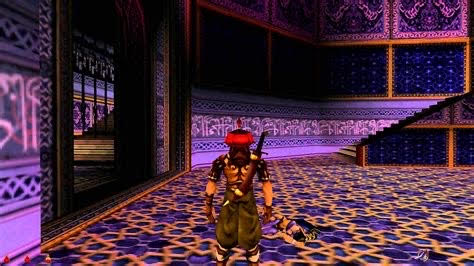
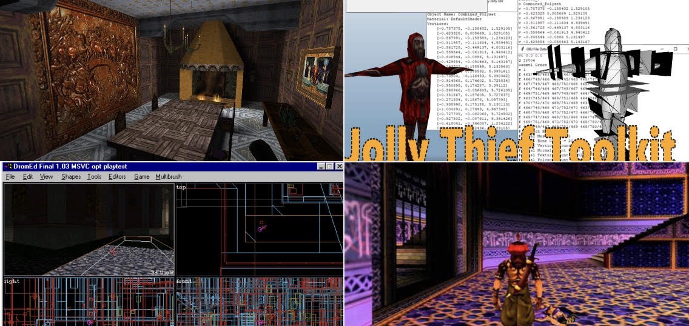
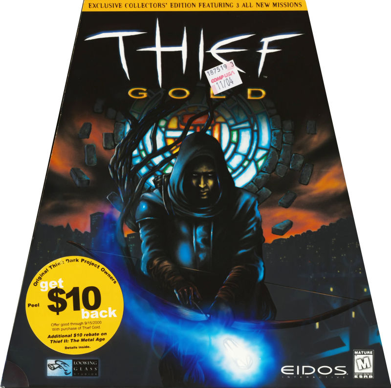
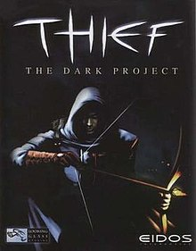
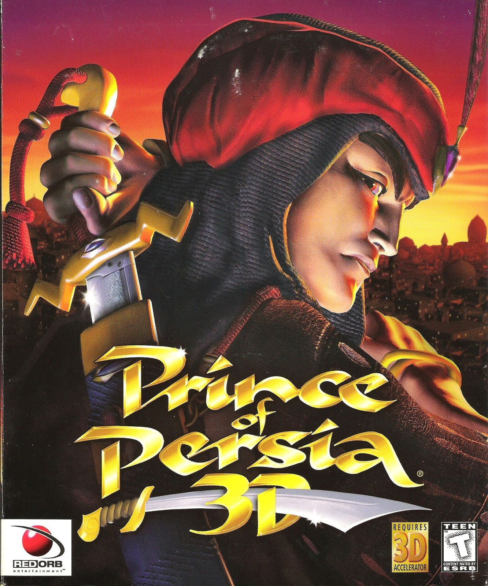

# thief-gold-prince-of-persia-3d
## Thief Gold: Prince of Persia 3D — The Remake
A total conversion project that fuses the stealth-driven shadow gameplay and immersive-sim systems of *Thief Gold* with the acrobatic platforming, trap-laden level design, and atmospheric world of *Prince of Persia 3D* (1999), rebuilt as a standalone remake.

## GitHub Treeview
[https://treegit.macosxjs.com/?url=igiteam/thief-gold-prince-of-persia-3d](https://treegit.macosxjs.com/?url=igiteam/thief-gold-prince-of-persia-3d)

## GitHub Tree API (Direct JSON)
[https://api.github.com/repos/igiteam/thief-gold-prince-of-persia-3d/git/trees/main?recursive=1](https://api.github.com/repos/igiteam/thief-gold-prince-of-persia-3d/git/trees/main?recursive=1)

## Prince of Persia 3D — the base of the gameplay

## WS11WineCX20.0.4 (macOS Big Sur 32-bit)

[WS11WineCX20.0.4.tar.7z](https://github.com/vitor251093/porting-kit-engines/releases/download/wineskin/WS11WineCX20.0.4.tar.7z)

---

### Reference Links
- [https://www.moddb.com/games/thief-the-dark-project/mods](https://www.moddb.com/games/thief-the-dark-project/mods)
- [https://dromed.whoopdedo.org](https://dromed.whoopdedo.org)
- [https://www.gamefront.com/games/thief](https://www.gamefront.com/games/thief)
- [https://thief-thecircle.com](https://thief-thecircle.com)
- [https://github.com/JonnyBro/beatrun/](https://github.com/JonnyBro/beatrun/)
- [https://www.moddb.com/games/thief-the-dark-project/downloads/dromed](https://www.moddb.com/games/thief-the-dark-project/downloads/dromed)
- [https://www.moddb.com/games/thief-the-dark-project/addons](https://www.moddb.com/games/thief-the-dark-project/addons)
- [https://ttlg.com/forums/showthread.php?t=114292&page=1](https://ttlg.com/forums/showthread.php?t=114292&page=1)
- [http://www.thief-thecircle.com/media/patches/](http://www.thief-thecircle.com/media/patches/)
- [https://www.moddb.com/mods/prince-of-persia-3d](https://www.moddb.com/mods/prince-of-persia-3d)
- [https://community.pcgamingwiki.com/files/file/2241-prince-of-persia-3d-widescreen-fix/](https://community.pcgamingwiki.com/files/file/2241-prince-of-persia-3d-widescreen-fix/)
- [https://popuw.com/index3.html](https://popuw.com/index3.html)
- [https://popuw.com/mods3.html](https://popuw.com/mods3.html)
- [https://www.gamepressure.com/download/prince-of-persia-3d-pop3d-widescreen-fix-mod/zf137ca](https://www.gamepressure.com/download/prince-of-persia-3d-pop3d-widescreen-fix-mod/zf137ca)
- [https://www.gamefront.com/DromEdToolkit+10zip/;13838841;/fileinfo.html](https://www.gamefront.com/DromEdToolkit+10zip/;13838841;/fileinfo.html)
- [https://www.moddb.com/games/thief-the-dark-project/downloads/jolly-thief-toolkit-v1](https://www.moddb.com/games/thief-the-dark-project/downloads/jolly-thief-toolkit-v1)
- [https://www.moddb.com/mods/tfix/downloads/tfix-127b](https://www.moddb.com/mods/tfix/downloads/tfix-127b)
- [https://www.thiefguild.com/fanmissions/?games=5](https://www.thiefguild.com/fanmissions/?games=5)
- [https://www.ttlg.de/index.php?article/15-komag-tut-vt2/](https://www.ttlg.de/index.php?article/15-komag-tut-vt2/)
- [https://next.nexusmods.com/games/thiefthedarkproject](https://next.nexusmods.com/games/thiefthedarkproject)
- [https://thiefmissions.com/search.cgi?search=&sort=release&limit=20#m](https://thiefmissions.com/search.cgi?search=&sort=release&limit=20#m)
- [https://gamebanana.com/tuts/games/19371](https://gamebanana.com/tuts/games/19371)
- [https://nickdablin.wordpress.com/absolute-beginners-guide-to-creating-a-mission-for-thief-2](https://nickdablin.wordpress.com/absolute-beginners-guide-to-creating-a-mission-for-thief-2/)
- [https://nickdablin.wordpress.com/how-to-play-thief-fan-missions/#thief-gold-installation-and-setup](https://nickdablin.wordpress.com/how-to-play-thief-fan-missions/#thief-gold-installation-and-setup)
- [https://nickdablin.wordpress.com/dromed-tutorials/](https://nickdablin.wordpress.com/dromed-tutorials/)
- [http://www.thief-thecircle.com/teg-old/guides/official/tutor.asp](http://www.thief-thecircle.com/teg-old/guides/official/tutor.asp)
- [https://nickdablin.wordpress.com/how-to-play-thief-fan-missions/](https://nickdablin.wordpress.com/how-to-play-thief-fan-missions/)
- [https://thief.starforge.co.uk/wiki/Tutorials:Contents](https://thief.starforge.co.uk/wiki/Tutorials:Contents)
- [https://thiefmissions.com/tutorials/Spike14CompleteTut.html](https://thiefmissions.com/tutorials/Spike14CompleteTut.html)
- [https://www.ttlg.de/index.php?article-list/](https://www.ttlg.de/index.php?article-list/)
- [A beginner's guide for Thief 1: The Dark Project Classic](https://steamcommunity.com/sharedfiles/filedetails/?id=2731118621)
- [https://thief.starforge.co.uk/images/5/56/Tutorials_SalvagesDromedMapsTutorialV2.pdf](https://thief.starforge.co.uk/images/5/56/Tutorials_SalvagesDromedMapsTutorialV2.pdf)
- [https://www.ign.com/articles/2006/09/05/thief-ii-the-metal-age-dromed-faq-374813](https://www.ign.com/articles/2006/09/05/thief-ii-the-metal-age-dromed-faq-374813)
 
## Dev Environment

**Official White Wii Remote With Nunchuk — Tested And Working — £14.99**
[https://www.ebay.co.uk/itm/800847189353](https://www.ebay.co.uk/itm/800847189353)

**Infrared Sensor Bar USB for Wii Emulator Remote Motion Detection Setup — £6.69**
[https://www.ebay.co.uk/itm/227423830875](https://www.ebay.co.uk/itm/227423830875)

**Apple MacBook Pro Retina 15in (2014) i7 2.8GHz 16GB 1TB SSD GT 750M — £120.30**
[https://www.ebay.co.uk/itm/800844561513](https://www.ebay.co.uk/itm/800844561513)

**WS11WineCX20.0.4 (Wine engine)**
[https://igiteam.github.io/wine_engines/](https://igiteam.github.io/wine_engines/)

**Official Genuine Sony PS3 PlayStation 3 DualShock 3 Wireless Controller Black — £19.99**
[https://www.ebay.co.uk/itm/840031043465](https://www.ebay.co.uk/itm/840031043465)

**Amazon Basics 4K HDMI Cable 3m — 18Gbps High Speed with Ethernet, 4K@60Hz, 2160p — £8.44**
[https://www.ebay.co.uk/itm/327352257557](https://www.ebay.co.uk/itm/327352257557)

**wiimote_nunchuk_macosx**
[https://github.com/igiteam/wiimote-nunchuk](https://github.com/igiteam/wiimote-nunchuk)

**xbox360_input_gui_py**
[https://github.com/igiteam/xbox360_input_gui_py](https://github.com/igiteam/xbox360_input_gui_py)

**logitec_mx_mouse_3_macos**
[https://github.com/igiteam/logitec_mx_mouse_3_macos](https://github.com/igiteam/logitec_mx_mouse_3_macos)

**igi1-macbook-3d-workstation**
[https://github.com/igiteam/igi1-macbook-3d-workstation](https://github.com/igiteam/igi1-macbook-3d-workstation)

---

## Thief Gold - Making a Profit mod source code

Author                  : vfig (Andy Durdin)
Contact Info            : me@andy.durdin.net
Homepage                : http://backslashn.com
Version                 : 1.2
Date of Release         : Jun 25, 2021

Description:

A professional acquaintance of mine, Argaux, got in touch with an offer
of a job in Newbridge. He won't give me any details--maybe he's afraid
I'll do it on the sly and he'll lose out on his fee?--but he says it's
urgent. And it pays generously.

I've never been to Newbridge before, but I hear it's a dark, quiet little
backwater on the outskirts of the city. The area's under the thumb of
Lady di Rupo, a wealthy grandee with a fancy mansion up on the cliffside.
I'll need to keep an eye open for her guards while I'm in the
neighbourhood: they're not exactly welcoming to thieves.

Reportedly the Hammers have recently started trying to wrestle control of
the district for themselves, and this has been causing trouble. People
tell me di Rupo has no love for the Order of the Hammer--but then neither
do I. Although I do like all the gold they use to decorate their temples.

Whatever else this job entails, visiting Newbridge will be an interesting
change of scene. I'll go along and meet Argaux by the fountain, and hear
what he has to say.

---

* Summary *

Game                    : Thief Gold, NewDark 1.26
Mission Title           : Making a Profit
File Name               : miss20.mis
Briefing                : Yes
Difficulty Settings     : Normal/Hard/Expert
Equipment Store         : Yes
Map                     : Yes
Auto Map                : Yes
New Graphics            : Yes
New Sounds              : Yes
Multi-Language Support  : Yes (English, French, German, Italian, Russian)
Build Time              : 670 Dromed hours / 150 days

---

* Installation *

The NewDark 1.26 patch or later is required to run this mission. The GOG
release of Thief Gold is recommended, as it comes with the latest NewDark
preinstalled:

https://www.gog.com/game/thief_gold

If your Thief Gold comes from another source, you must apply the NewDark
1.26 patch manually (http://www.ttlg.com/forums/showthread.php?t=146448)
or using TFix (http://www.ttlg.com/forums/showthread.php?t=134733) version
1.26a or later. This mission was designed with the original low-resolution
textures and models in mind, and the use of any enhancement packs or texture
packs is not recommended. They won't break anything, but parts of the mission
might not look as intended.

You should use NewDark's FMSel feature to run this mission. If you don't have
one already, create a directory for mission zips, and move this zip file in
there, without unpacking it. When launching FMSel for the first time, it will
ask you if you want to configure an archive path: tell it yes, and select
this directory. FMSel will then manage unpacking and installing the mission
for you.

To launch the FM selector, run the game with the -fm argument:

THIEF.EXE -fm

Alternatively you can edit CAM_MOD.INI to always run the FM selector; the
instructions for doing this are in the file. Please see FMSel.pdf in your
NewDark distribution for more information on using FMSel.

If you prefer a different mission loader, such as NewDarkLoader, then you
already know what to do.

---

* Configuration *

The 'new mantle' feature in NewDark makes climbing easier and significantly
more reliable, so I recommend using it. However, the mission has been fully
tested without it, so if you prefer the original climbing behaviour, you
will be fine.

If you want to enable 'new mantle', edit USER.CFG in your Thief Gold
directory and add the following line:

new_mantle

Note that changes made to USER.CFG will take effect for the entire game and
all fan missions.

---

* Languages and Subtitles *

This mission contains subtitles for all its new dialog. To enable them, edit
USER.CFG in your Thief Gold directory and add the following line:

enable_subtitles

Subtitles will be shown in the same language as texts, where available (see
below for more on configuring languages). Please see subtitles.txt in your
NewDark distribution for more information on configuring font sizes and
colours, and what kinds of speech and sound effects subtitles will be shown
for.

If you want subtitles for all the stock Thief dialog and sound effects, you
will have to install a Thief Gold subtitle pack. An English subtitle pack can
be found at http://www.ttlg.com/forums/showthread.php?t=144354

Texts and subtitles for this mission are available in English, French, German,
Italian, and Russian. The 'language' setting in INSTALL.CFG sets the languages
used by the game. By default this is set to the language that your version of
Thief uses. If you prefer to have text and subtitles in a different language
where available, you must edit INSTALL.CFG, and add your preferred language at
the start of the setting, followed by a '+'.

For example, if you are playing the English version of Thief, but would
prefer to see Italian texts in the mission, you would edit INSTALL.CFG and
change this line:

language english

To this:

language italian+english

Note that changes made to INSTALL.CFG and USER.CFG will take effect for the
entire game and all fan missions.

---

* Distant Buildings *

This mission is quite aggressive on view distances, as the hilltop and some
other parts of the city are visible from almost everywhere. From some vantage
points, you may occasionally see distant buildings appear and vanish. If this
bothers you, find and disable the 'wr_render_zcomp' setting in CAM_EXT.CFG.

Note that changes made to CAM_EXT.CFG will take effect for the entire game
and all fan missions.

---

* Credits *

Created by              : vfig (Andy Durdin)

Story                   : vfig
             : Aaron Dron

Briefing illustrations  : Kayleigh Boyd

Voice acting:
Garrett             : M. Alasdair MacKenzie
Lady di Rupo        : Shadow Creepr
The Keeper          : Yandros
The Eternal Benny   : Yandros
Irate Sergeant      : MasterThief3
Heathen guard       : Yandros
Cowardly Hammerite  : McTaffer
Danno the meister   : Yandros
Olver the digger    : McTaffer
Morten the berk     : (Nobody, cause he's dead)
Hammerite priest    : McTaffer
Hammerite watchman  : Yandros

Translation:
French              : Athalle
German              : baeuchlein
Italian             : piesel
Russian             : MoroseTroll

Proofreading            : gnartsch

Beta testing            : Alex Lemcovich
             : bob_doe_nz
             : Cardia
             : Dillon Rogers
             : Dr.Sahnebacke
             : Freddy Fox
             : Gloria Creep
             : itllrun10s
             : Justin Keverne
             : M. Alasdair MacKenzie
             : marbleman
             : nightshifter
             : Norgg
             : prjames
             : R Soul
             : Rachel Crawford
             : Ravenhook

Special thanks:

To Skacky, Unna Oertdottir, and Yandros for their help when Dromed tried
to murder this mission in its infancy.

To Athalle and Fortuni for putting me in touch with the translators and
giving me a place on the 'Shadow' forum.

To Tannar, Brethren, and Dussander for providing the 'Shalebridge Cradle'
and 'Southquarter' beta test forums.

To 'Le Corbeau', for NewDark.

To all the fan mission authors who came before me and inspired me to get
my hands dirty with Dromed.

To all you taffers out there, on TTLG and beyond, who have kept Thief
alive for the past twenty years!

---

* Version history *

Jun 25, 2021 (1.2):

Expert difficulty has 300 more starting cash, to compensate for the lack of
starting equipment.

Eating food now has a small chance of healing, as in Thief 2.

Southern works station switch will now turn off street lights in the
square.

Added more fire arrows and powder kegs, for the convenience of pyromaniacs.

"G-man" Keeper remains visible slightly longer, so people will maybe notice
him now.

Moved four coin stacks (100 loot) to new location, to better reward
explorers.

The "Sanctuary key" now opens more doors, as it always ought to have done.

Fixed pathfinding for Milton in the Hammerite library.

Added a glowing mushroom to the caves for slightly better visibility.

Buckets can now be frobbed, mostly.

Apr 20, 2020 (1.1):

Fixed "Take the Anax" objective being ticked off too early if the player
had KO'd the Anax and picked him up before learning about the quest.

Fixed readables sometimes being unreadable due to mismatch between font
and book image palettes with books/parch.

Nov 27, 2018 (1.0):

Initial release.

---
* Copyright Notice *

This mission is ©2018-2021 by Andy Durdin.

Distribution of this mission is allowed as long as it is free and unmodified.

This level was not made and is not supported by Looking Glass Studios or Eidos
Interactive.
